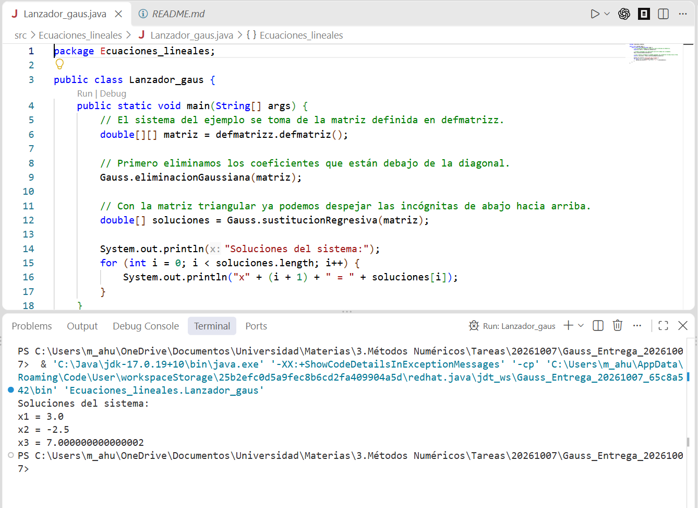

# Método de Gauss

**Alumno:** Mauricio Ahued Cortés  
**Materia:** Métodos Numéricos, unidad 3  
**Docente:** Víctor Hugo Vásquez Herrera

Programa en **Java**, basado en el código del profesor, que resuelve un sistema de ecuaciones mediante el método de Gauss. Primero obtiene una matriz triangular y después despeja las incógnitas desde la última ecuación.

El código está separado en tres clases dentro de `src/Ecuaciones_lineales/`:

- `defmatrizz.java`: guarda los datos del sistema.
- `Gauss.java`: realiza la eliminación gaussiana y la sustitución regresiva.
- `Lanzador_gaus.java`: llama a los métodos e imprime las soluciones.

## Compilar y ejecutar

Se necesita un JDK 17 o posterior. Abrir una terminal en la carpeta del proyecto y ejecutar:

```text
mkdir out
javac --release 17 -encoding UTF-8 -d out src/Ecuaciones_lineales/Gauss.java src/Ecuaciones_lineales/defmatrizz.java src/Ecuaciones_lineales/Lanzador_gaus.java
java -cp out Ecuaciones_lineales.Lanzador_gaus
```

Si la carpeta `out` ya existe, omitir el primer comando.

## Ejemplo de ejecución

La matriz definida en `defmatrizz.java` corresponde a este sistema:

```text
3x1 - 0.1x2 - 0.2x3 = 7.85
0.1x1 + 7x2 - 0.3x3 = -19.3
0.3x1 - 0.2x2 + 10x3 = 71.4
```

Salida obtenida en consola:

```text
Soluciones del sistema:
x1 = 3.0
x2 = -2.5
x3 = 7.000000000000002
```

El último resultado es una aproximación de `7` por el uso de `double`. El programa utiliza esta matriz fija, sin pedir datos por consola. Es Gauss simple y necesita pivotes distintos de cero durante el cálculo.

Captura de la ejecución:


